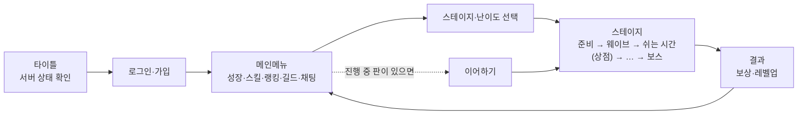

# ProjectWarrior


**혼자 스테이지의 웨이브와 보스를 막아 내는 3인칭 액션 게임입니다.** Unreal Engine 5.8.3 · C++로 만들었고, 전투는 Gameplay Ability System(GAS), 적은 비헤이비어 트리·EQS로 움직입니다. 계정·성장·스테이지 구성·랭킹·길드·채팅은 게임 서버([PW01WebServer](https://github.com/NBCGameServerCamp09Team01/PW01WebServer))와 연동하고, 서버가 그 값의 원본입니다.

- 작업 공간 루트: [PW01](https://github.com/NBCGameServerCamp09Team01/PW01) (이 폴더는 루트 안의 `PW01\ProjectWarrior\`). 게임 ↔ 서버 약속은 루트 `docs/contracts/`
- 기준 브랜치는 **`dev`** 입니다. 브랜치·커밋·LFS 규칙은 루트 `docs/git-workflow.md`

| 항목 | 값 |
|---|---|
| 엔진 | Unreal Engine 5.8.3 (런처 버전) |
| 언어 | C++ (모듈 `ProjectWarrior`) + 블루프린트·UMG |
| 주요 기능 | Gameplay Abilities·Tags·Tasks, Enhanced Input, AI(비헤이비어 트리·EQS), UMG, Motion Warping |
| 플러그인 | ALS-Community(캐릭터 이동), UEGitPlugin, VibeUE·ModelContextProtocol(에디터 자동화) |
| 서버 연동 | HTTP(JSON) + WebSocket, 모듈 `HTTP`·`WebSockets`·`Json` |

---

## 게임 흐름



- 스테이지는 상태 7개(`Initializing → Preparing → InProgress → WaveCleared → Resting → … → StageCleared / StageFailed`)를 `WarriorStageFlowManager`가 넘기고, 판 구성(웨이브·적·배율)은 서버가 판 시작 때 정해 줍니다.
- 판 도중 게임이 꺼지면 다음 로그인 때 같은 판을 이어 합니다(웨이브 클리어마다 체크포인트).

## 주요 시스템

| 영역 | 내용 | 폴더 |
|---|---|---|
| 전투 | 플레이어·적·보스 모두 GAS(능력·속성·GE·피해 계산), 무기·활·투사체·락온·전술 모드 | `AbilitySystem/`, `Components/`, `Items/` |
| AI·보스 | 비헤이비어 트리·EQS, 공격 토큰, 보스 패턴 세트 | `Characters/`, `Tasks/`, `Decorators/`, `Services/`, `EQS/` |
| 스테이지 | 상태 흐름, 웨이브 스폰, 서버 웨이브 계획 적용, 난이도 배율, 판 통계 | `Stage/`, `GameModes/`, `Stats/` |
| 판 안 성장 | 상점·인벤토리·강화 | `Shop/`, `Components/` |
| 튜토리얼 | 구역·단계 데이터 | `Tutorial/` |
| 서버 연동 | GameInstance 서브시스템: `Api`(보내기·다시 보내기·못 보낸 결과 보관), `Auth`, `StageList`·`StagePlay`·`PlayCheckpoint`, `StatInvest`·`SkillUnlock`, `Ranking`, `Guild`, `Chat`, `Realtime`(WebSocket) | `Network/`, `Auth/`, `Account/`, `Skill/`, `Chat/` |
| 화면 | 타이틀·로그인·메인메뉴·스테이지 선택·성장·스킬·랭킹·길드·채팅·HUD·일시정지·결과 | `Widgets/`, `Content/MyGameContents/UI/` |

- 서버와 말하는 곳은 GameInstance 서브시스템이라, 메인메뉴 ↔ 스테이지로 맵이 바뀌어도 로그인·계정 사본·보내던 요청이 남습니다.
- 서버 오류는 오류 코드 → 문구·보여 주는 방법 표(`Network/WarriorErrorText.cpp`) 한 곳에서 고릅니다.

## 폴더

```
ProjectWarrior/
├─ ProjectWarrior.uproject
├─ Config/                      ← DefaultEngine/Game/Input.ini (서버 주소·채팅 창·맵 설정 등)
├─ Source/ProjectWarrior/       ← C++ (위 표의 폴더들, 자동 시험은 각 폴더의 Tests/)
├─ Content/MyGameContents/      ← 팀 에셋: Maps, UI, Character, GameplayAbility/Effect, Stage, Shop, Skill, Audio, VFX …
├─ Plugins/                     ← ALS-Community, UEGitPlugin, VibeUE
├─ RawContent/                  ← 원본 이미지 등(LFS)
└─ Docs/                        ← 게임 쪽 문서(VibeUE 안내 등)
```

맵: `L_Front`(타이틀·메인메뉴, 패키지 시작 맵), `StageLevel_*`·`Region01/L_Stage_*`(스테이지), `Tutorial/L_Tutorial`

---

## 처음 받기

### 1. 준비물

- Unreal Engine **5.8.3**(Epic 런처), Visual Studio 2022(“C++를 사용한 게임 개발” 워크로드, `.vsconfig` 참고)
- [Git LFS](https://git-lfs.com): `.uasset`·`.umap`은 LFS로 저장되고 **잠금(lockable)** 대상입니다

### 2. 받기

루트에서 `tools\setup.bat game`을 실행하거나, `PW01\` 안에서:

```bat
git clone https://github.com/NBCGameServerCamp09Team01/ProjectWarrior.git
cd ProjectWarrior
git lfs install
git switch dev
```

### 3. 열기·빌드

- `ProjectWarrior.uproject` 오른쪽 클릭 → Generate Visual Studio project files → `.sln`으로 빌드하거나 `.uproject`를 열어 모듈 빌드를 승인합니다.
- 명령으로 빌드(에디터를 끈 상태):

```bat
"C:\Program Files\Epic Games\UE_5.8\Engine\Build\BatchFiles\Build.bat" ProjectWarriorEditor Win64 Development -Project="%CD%\ProjectWarrior.uproject" -WaitMutex
```

- 에디터가 켜진 채 `.cpp`만 고쳤으면 Live Coding(Ctrl+Alt+F11), 헤더(`UPROPERTY`·`UFUNCTION`)를 고쳤으면 에디터를 끄고 빌드합니다.

### 4. 서버 붙이기

| 실행 | 서버 주소 |
|---|---|
| 에디터 PIE·에디터에서 띄운 Standalone | 코드 기본값 `http://localhost:8080`(로컬 웹서버, 웹서버 README "처음 받기") |
| 패키지 | `Config/DefaultGame.ini`의 `PackagedBaseUrl`(배포 서버) |
| 둘 다 덮어쓰기 | 실행 인자 `-ServerUrl=http://localhost:8082` 같은 식 |

- 로그를 자세히 보려면 실행 인자 `-LogCmds="LogProjectWarrior Verbose"`(에디터 콘솔에서 켠 값은 Standalone에 안 넘어갑니다).
- 타이틀에서 서버 상태(`/health`)를 먼저 확인하고, 실패하면 안내 후 종료합니다.

### 5. 자동 시험

```bat
"C:\Program Files\Epic Games\UE_5.8\Engine\Binaries\Win64\UnrealEditor-Cmd.exe" "%CD%\ProjectWarrior.uproject" -ExecCmds="Automation RunTests ProjectWarrior;Quit" -unattended -nullrhi -nosplash -nosound
```

또는 에디터 Tools → Session Frontend → Automation에서 `ProjectWarrior.*`. 시험 정의 39개(10/19 `dev`): 전투 토큰, 스탯·스킬, 스테이지 흐름·웨이브·난이도, 서버 응답 읽기·재전송·보관, 채팅 규칙 등.

### 6. 개발용 콘솔 명령(Shipping 빌드 제외)

| 명령 | 하는 일 |
|---|---|
| `Warrior.Stage.Difficulty [0\|1\|2]` | 다음 입장 난이도 고르기/보기 |
| `Warrior.Stage.Pause` | 일시정지 |
| `Warrior.Checkpoint.Capture` · `Restore` · `Dump` · `ResumeLevel` | 이어하기 체크포인트 시험 |
| `Warrior.Chat.Send <global\|guild> <글>` · `History [older]` · `Dump` | 채팅 보내기·내역·상태 |

---

## 작업 규칙(요약)

- `Binaries/`, `Intermediate/`, `Saved/`, `DerivedDataCache/`는 커밋하지 않습니다.
- `.uasset`·`.umap`은 이진 파일이라 병합이 안 됩니다. 고치기 전에 `git lfs lock <경로>`, 병합 뒤 `git lfs unlock`. 담당자 승인 없이 저장·이동·삭제하지 않습니다(에디터 자동화 포함).
- 맵 하나는 담당자 한 명이 고칩니다.
- 서버와의 약속(요청·응답 모양, 오류 코드)을 바꿀 때는 루트 `docs/contracts/` 명세를 먼저 고칩니다.
- 비밀번호·토큰·서버 주소 같은 값은 코드·문서에 새로 적지 않습니다.
